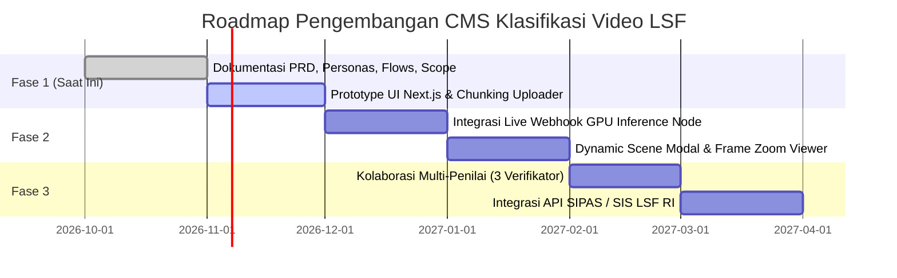

# Scope of Work (Project Scope)
## CMS Klasifikasi Video LSF RI

Dokumen ini menguraikan batasan cakupan proyek (*Project Boundaries*) untuk pengembangan CMS Klasifikasi Video LSF RI. Definisi cakupan ini memastikan bahwa seluruh proses pengembangan berfokus pada sasaran nilai utama, mencegah pemekaran cakupan (*scope creep*), serta menetapkan ekspektasi teknis yang jelas bagi pengembang dan pemangku kepentingan (*stakeholders*).

---

```
┌─────────────────────────────────────────────────────────────────────────────────┐
│                          CAKUPAN PROYEK CMS LSF RI                              │
├───────────────────────────────────────┬─────────────────────────────────────────┤
│          IN-SCOPE (Dikerjakan)        │        OUT-OF-SCOPE (Tidak Dikerjakan)  │
├───────────────────────────────────────┼─────────────────────────────────────────┤
│ • Web CMS Fullstack (Next.js + Supabase)│ • Pelatihan / Fine-tuning Model AI/ML   │
│ • Resumable Chunked Video Uploader    │ • Timeline Video Editing / NLE Internal │
│ • Job Progress & Polling API Status   │ • Portal Publik Produser / OTT Eksternal│
│ • Penampil Laporan Adegan & Bukti     │ • Otomatisasi Sensor Tanpa Manusia      │
│ • Verifikasi Rating & Input Catatan   │ • Transcoding Format Video Berat        │
│ • Arsip Riwayat, Audit & Ekspor JSON  │ • Sistem Pembayaran / PNBP Sensor       │
│ • Dasbor Statistik & Visualisasi Chart│ • Pemulihan Fisik Pita Film Seluloid    │
└───────────────────────────────────────┴─────────────────────────────────────────┘
```

---

## 1. Item Dalam Cakupan (In-Scope Items)

Fitur, modul, dan kapabilitas berikut ini merupakan bagian integral yang dikembangkan pada proyek CMS ini:

### 1.1 Antarmuka Pengguna & Dasbor Web (Frontend Web CMS)
* **Design System & Branding LSF:** Implementasi antarmuka bernuansa institusional resmi LSF RI, mencakup bilah atas (*topbar*) dengan lencana logo LSF, indikator pill rating (`SU`, `13+`, `17+`, `21+`), dan bilah navigasi (*sidebar*) responsif.
* **Modul Home (LSF Data Dashboard):**
  * Visualisasi cincin distribusi persentase klasifikasi usia.
  * Kartu statistik 5 tahunan (2020–2025).
  * Tabel Rekapitulasi Sensor Film dengan tombol unduh CSV dan fitur cetak (*print view*).
* **Modul Klasifikasi Video:**
  * Zona unggah berkas (*drag-and-drop*) dengan instruksi *chunking*.
  * Indikator progres multi-tahap (Validasi File, Ekstraksi Frame, Klasifikasi Adegan AI).
  * Tabel Laporan Adegan: stempel waktu (*timecode*), deskripsi adegan, chip tag (contoh: *Dialog*, *Kekerasan*), tingkat risiko (*Rendah*, *Tinggi*), thumbnail bukti frame, dan kolom catatan peninjauan.
  * Kartu ringkasan rating dan rekomendasi peninjau.
  * Panel riwayat analisis terkini di sisi kanan layar.
* **Modul Riwayat Analisis:**
  * 4 kartu metrik operasional (Total Video, Status Selesai/Terverifikasi, Sedang Diproses GPU, Butuh Tinjauan Verifikator).
  * Baris pencarian fleksibel (ID Tiket LSF, Nama Berkas, Hash SHA-256).
  * Filter bulan kalender dan urutan unggahan (*sorting*).
  * Tombol aksi unduh Master JSON, *single JSON*, dan ekspor batch CSV.
* **Modul Laporan:**
  * 4 kartu ringkasan medium (Total, Layar Lebar, Televisi, JTI) beserta persentase tren bulanan.
  * Grafik batang klasifikasi usia (`SU`, `13+`, `17+`, `21+`).
  * Grafik lingkaran (*pie chart*) sebaran persentase genre (Horror, Comedy, Romance, Action, Lain-lain).

### 1.2 Logika Backend & Integrasi Data (Backend & BaaS)
* **Chunking Uploader Engine:**
  * Pemecahan berkas besar di sisi klien (5MB–10MB per partisi) dan pengiriman terkontrol ke Supabase Storage.
  * Endpoint rekonsiliasi penggabungan *chunk* (`/api/upload`).
  * Penghitungan dan validasi *checksum* SHA-256 berkas.
* **Job State & Status Tracking:**
  * Endpoint polling/webhook status inferensi (`/api/job-status`).
  * Pengelolaan status siklus hidup video (`queued` → `validating` → `processing` → `completed` / `failed`).
* **Format & Ekspor Data:**
  * Parser dan generator berkas Master JSON LSF terstandarisasi.
  * Utilitas ekspor data tabulasi ke CSV.
* **Skema Database Relasional (Supabase PostgreSQL):**
  * Tabel `videos`, `classification_jobs`, `scene_reports`, dan `audit_verifications`.
  * Kebijakan keamanan baris data (*Row-Level Security / RLS*).

---

## 2. Item Di Luar Cakupan (Out-of-Scope Items)

Area kerja berikut secara eksplisit **TIDAK TERMASUK** dalam cakupan proyek ini dan ditangani oleh sistem eksternal, tim terpisah, atau tahap di masa depan:

### 2.1 Pengembangan & Pelatihan Model AI/ML (AI Model Training & Weights)
* **Batas Lingkup:** CMS ini bertindak sebagai klien orkestrasi (*orchestration client*) yang mengirimkan pemicu (*trigger*) dan menerima payload JSON hasil analisis.
* **Yang Dikecualikan:**
  * Pelatihan ulang (*re-training*), pembuatan bobot (*weights*), atau penyesuaian parameter (*fine-tuning*) model vision multimodal (Qwen-VL, CLIP, atau YOLO).
  * Pengadaan dan pengelolaan kluster server komputasi fisik GPU (CUDA / TensorRT server farm).

### 2.2 Penyuntingan Video Non-Linear Internal (Video Editing / Trimming Tool)
* **Batas Lingkup:** CMS menyediakan pemutar pratinjau (*preview player*) dan penanda frame berbasis waktu (*read-only timestamp analysis*).
* **Yang Dikecualikan:**
  * Fitur penyunting video berbasis linimasa (*timeline NLE editor*) di dalam peramban web untuk memotong, memangkas (*cut/trim*), atau menyensor otomatis audio (*audio bleeping*) pada berkas video asli. Perubahan fisik berkas tetap dilakukan oleh pemilik materi/rumah produksi melalui software editing profesional eksternal.

### 2.3 Portal Pengajuan Mandiri Eksternal PH & OTT (Public Submission Ingestion Portal)
* **Batas Lingkup:** Sistem ini adalah CMS operasional internal untuk staf dan penilai LSF.
* **Yang Dikecualikan:**
  * Pembuatan portal publik yang dibuka langsung untuk umum, rumah produksi (PH bioskop), stasiun televisi nasional, atau penyedia layanan *Over-The-Top* (OTT / platform streaming) untuk mendaftar sensor secara mandiri.
  * Integrasi sistem pembayaran Penerimaan Negara Bukan Pajak (PNBP) sensor film.

### 2.4 Otomatisasi Hukum Sensor Penuh Tanpa Intervensi Manusia (Autonomous Censorship)
* **Batas Lingkup:** Sistem berpegang pada prinsip *Human-in-the-Loop*.
* **Yang Dikecualikan:**
  * Penerbitan Surat Tanda Lulus Sensor (STLS) secara otomatis langsung oleh algoritma AI tanpa persetujuan dan verifikasi tanda tangan Anggota Subkomisi Penilaian LSF.

---

## 3. Peta Jalan & Rencana Pengembangan Masa Depan (Future Roadmap)

Fitur-fitur potensial berikut diposisikan untuk fase ekspansi berikutnya setelah fase baseline (Fase 1 & MVP) rampung dan teruji stabil:



* **Fase 2 (Q1 2027):** Integrasi Webhook langsung dua arah dengan *worker* GPU inference secara *real-time* menggunakan Server-Sent Events (SSE) atau WebSocket.
* **Fase 3 (Q2 2027):** Fitur *multi-reviewer consensus*: modul penelaahan bersama di mana 3 verifikator dapat memberikan skor pertimbangan independen secara serentak sebelum keputusan sidang pleno.
* **Fase 4 (Q3 2027):** Integrasi dengan pangkalan data SIPAS (Sistem Informasi dan Pelayanan Administrasi Sensor) LSF RI untuk sinkronisasi nomor registrasi Surat Tanda Lulus Sensor (STLS).
