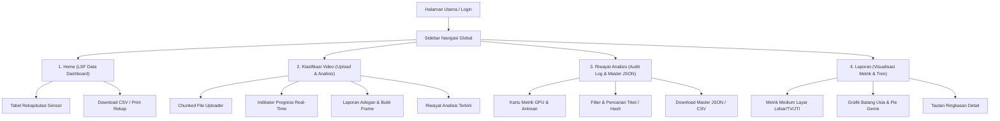
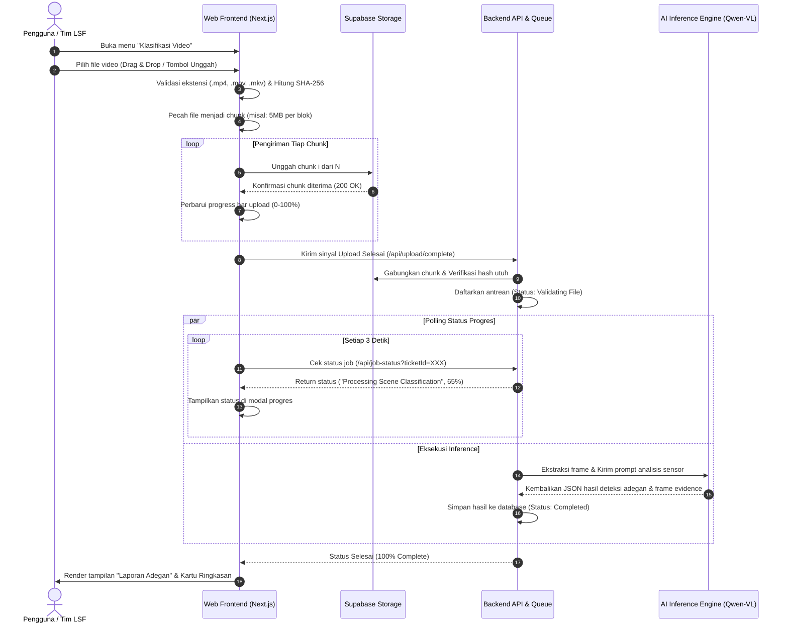
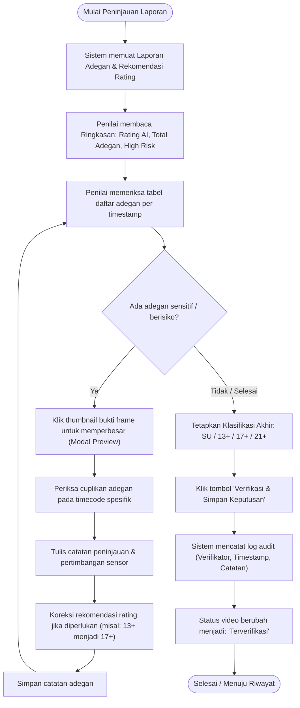
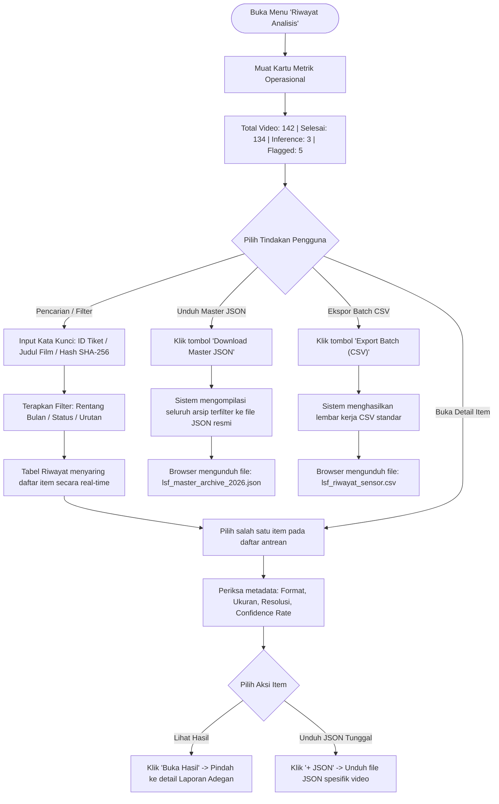
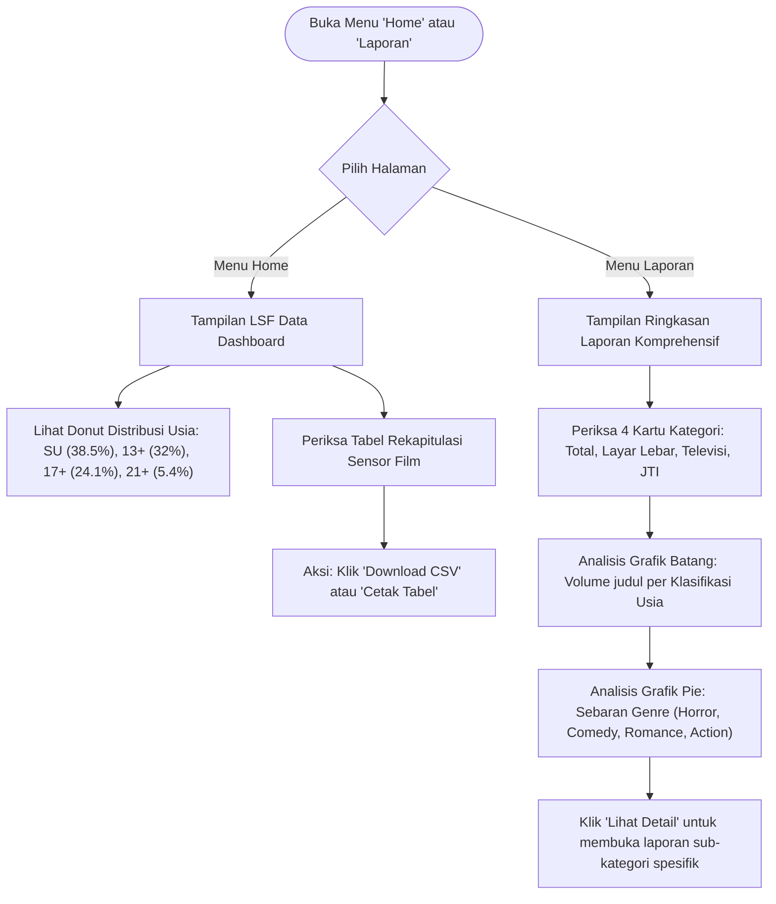

# User Flows
## CMS Klasifikasi Video LSF RI

Dokumen ini memetakan seluruh alur interaksi pengguna (*User Flows*) di dalam sistem CMS Klasifikasi Video LSF RI, mulai dari proses pengunggahan video berukuran besar, peninjauan hasil analisis kecerdasan buatan, pemantauan riwayat arsip, hingga penyusunan laporan statistik eksekutif.

---

## 1. Peta Navigasi Global (Site Map & Navigation Flow)

---

## 2. User Flow 1: Unggah & Pemrosesan Video (Chunked Upload & Inference)

Alur ini dijalankan saat pengguna (Verifikator Sensor atau Tim IT) mengunggah materi sensor video baru untuk dianalisis oleh sistem.

### 2.1 Diagram Alur (Mermaid)

### 2.2 Langkah-Langkah Operasional
1. **Inisiasi:** Pengguna membuka menu navigasi **Klasifikasi Video**.
2. **Pemilihan Berkas:** Pengguna mengklik tombol *"Unggah Video"* atau menyeret berkas video ke dalam *upload zone*.
3. **Validasi Klien:** Klien memvalidasi tipe MIME dan menyiapkan fungsi *chunking* berbasis JavaScript `Blob.slice()`.
4. **Unggah Partisi (*Chunking*):** Sistem mengirimkan potongan berkas secara berurutan atau paralel terkendali ke *bucket* penyimpanan. Jika ada kegagalan koneksi di salah satu *chunk*, sistem secara otomatis melakukan *retry* hanya pada bagian tersebut.
5. **Pemantauan Status (*Real-Time Feedback*):**
   - Layar menampilkan animasi dan label progres:
     - *"Memvalidasi integritas berkas..."*
     - *"Mengekstrak frame video..."*
     - *"Video sedang dianalisis oleh sistem (Klasifikasi Adegan)..."*
6. **Penyajian Hasil:** Setelah komputasi tuntas, sistem memuat tampilan **Laporan Adegan** lengkap dengan kartu rating, statistik risiko, dan baris detail temuan adegan.

### 2.3 Penanganan Kasus Khusus (Edge Cases)
* **Koneksi Terputus Saat Upload:** Klien menyimpan status indeks *chunk* terakhir di `localStorage`. Saat koneksi pulih, tombol *"Lanjutkan Unggah"* diaktifkan tanpa memulai dari nol.
* **Format File Tidak Didukung:** Menampilkan pesan galat *"Format berkas tidak didukung. Mohon gunakan MP4, MOV, atau MKV."*
* **Kelebihan Beban Antrean (Queue Full):** Jika *node* GPU sedang penuh, sistem menampilkan status *"Dalam antrean nomor urut X"* dengan estimasi waktu tunggu.

---

## 3. User Flow 2: Peninjauan Analisis & Penetapan Klasifikasi (Review & Verification)

Alur ini merupakan inti dari mekanisme kerja Anggota Subkomisi Penilaian LSF dalam menelaah draf rekomendasi AI dan menetapkan keputusan sensor resmi.

### 3.1 Diagram Alur (Mermaid)

### 3.2 Langkah-Langkah Operasional
1. **Pemeriksaan Ringkasan Awal:** Verifikator meninjau kartu statistik di bagian atas tabel:
   - Draf Rating Awal (misal: `13+` atau `17+`)
   - Jumlah Total Adegan yang diekstrak
   - Jumlah Adegan *High Risk* (adegan kritis dengan tingkat kekerasan/sensualitas tinggi)
2. **Inspeksi Baris Adegan:** Verifikator membaca baris demi baris tabel adegan:
   - Memeriksa stempel waktu (*timecode*, contoh: `00:10`).
   - Membaca deskripsi temuan adegan dan tag kategori (*Dialog*, *Kekerasan*, *Horor*).
   - Mengamati *chip* tingkat risiko (*Rendah*, *Sedang*, *Tinggi*).
3. **Pemeriksaan Bukti Frame:** Mengklik bukti frame (contoh: *Frame 1 pada 0:00, Frame 2 pada 0:05*) untuk membuka jendela pratinjau resolusi tinggi guna memastikan tidak ada bias dari AI.
4. **Pemberian Catatan Khusus:** Verifikator mengisi kolom *Catatan Peninjauan* jika adegan tersebut memerlukan pemotongan (*cut*) atau revisi audio (*dialog bleep*).
5. **Finalisasi & Penetapan Rating:** Verifikator memilih rating akhir resmi dan menekan tombol verifikasi. Sistem menyimpan status sebagai `Terverifikasi` dan memperbarui data rekapitulasi.

---

## 4. User Flow 3: Monitoring, Audit Log, & Ekspor Arsip (Riwayat Analisis)

Alur ini digunakan oleh Administrator IT dan Tim Penilai untuk memantau beban sistem, mencari tiket sensor terdahulu, serta mengunduh master berkas JSON/CSV.

### 4.1 Diagram Alur (Mermaid)

### 4.2 Langkah-Langkah Operasional
1. **Akses Arsip:** Pengguna menavigasi ke menu **Riwayat Analisis**.
2. **Pemantauan Kesehatan Beban:** Memeriksa 4 kartu metrik utama di bagian atas untuk memastikan tidak ada antrean inference yang mandek (*stuck*).
3. **Pencarian Cepat:** Memasukkan parameter pelacakan (misal ID Tiket `LSF-2026-X8910` atau judul film).
4. **Pengunduhan Dokumen:**
   - Untuk integrasi sistem database eksternal: Klik *"Download Master JSON"*.
   - Untuk laporan spreadsheet berkala pimpinan: Klik *"Export Batch (CSV)"*.
   - Untuk data per judul film: Klik tombol *"+ JSON"* pada kartu judul terkait.

---

## 5. User Flow 4: Pelaporan Eksekutif & Statistik LSF (Dashboard & Laporan)

Alur ini memfasilitasi kebutuhan pimpinan, sekretariat komisi, dan staf analitik LSF dalam memantau tren sensor film nasional.

### 5.1 Diagram Alur (Mermaid)

### 5.2 Langkah-Langkah Operasional
1. **Akses Dashboard:** Pengguna membuka menu **Home** untuk melihat ringkasan cepat distribusi klasifikasi usia lima tahunan (2020–2025).
2. **Analisis Komparatif:** Pengguna membuka menu **Laporan** untuk melihat dinamika pergeseran platform tayang:
   - Pertumbuhan materi bioskop (*Layar Lebar*) vs. siaran kabel/terestrial (*Televisi*) vs. media digital (*JTI*).
   - Memantau tren persentase peningkatan bulanan (indikator `↑12% dari bulan sebelumnya`).
3. **Pencetakan / Distribusi:** Mengklik tombol cetak untuk mencetak laporan ke format PDF siap edar untuk rapat pleno anggota LSF.
